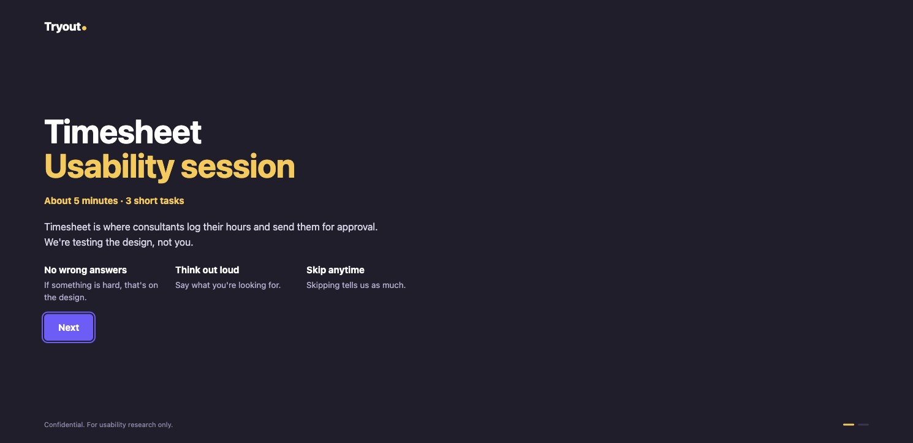
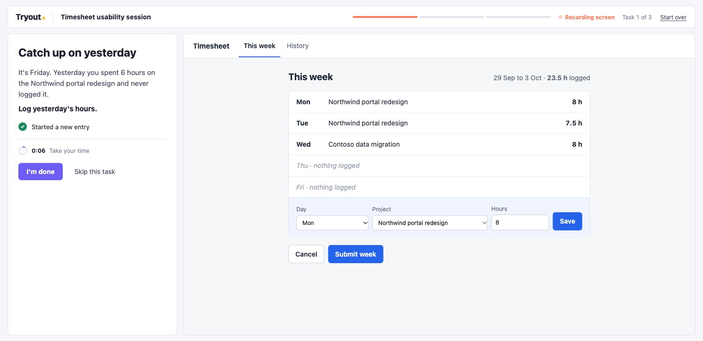
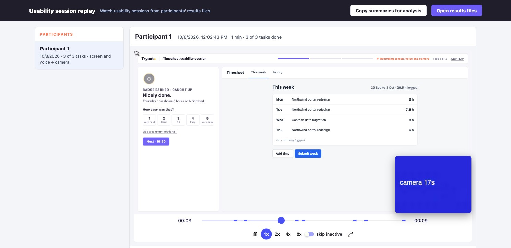

# Tryout

**An open usability test kit. One HTML file to send, one file back, every session replayable.**

Tryout turns a prototype into an unmoderated usability test that you can email to anyone. Participants open the file, work through a few short story tasks on the live prototype, and send back one results file. You replay every session with the cursor, the clicks, their voice and, if they chose to, their camera. Nothing is installed, nothing is uploaded, and no account is needed on either side.

It was built for a real product team that needed to run tests across projects and get the same format every time. Then it was made generic, so any team can use it. An AI tool can build a complete test from your designs or prototype with the prompt in this kit, and you can also edit everything by hand.

## Demo

A short walkthrough of a Tryout session, from the intro to the replay.

https://github.com/Aniruddha-Sainkar/tryout/raw/main/docs/tryout-demo.mp4

Prefer YouTube? [Watch the demo there](https://youtu.be/B6m9eyfLMAM). If the player above does not load, [download it](docs/tryout-demo.mp4) (about one minute).

## How it works

**For the participant**

1. They open the HTML file in their browser. A short intro explains what the session is, and that the design is being tested, not them.
2. They tick what they are happy to record: the screen (on by default), their voice, their camera (off by default).
3. One task at a time: a short story that sets the scene and ends with the ask. No button names, no instructions. A quiet timer, a hint only on request, and I'm done or Skip at any point.
4. After each task: a badge, a 1 to 5 ease rating or the reason for skipping, an optional comment.
5. At the end: two closing questions, then a results file downloads. They email it to you.

**For the researcher**

- Open the results files in `kit/session-replay.html`. Pick a participant, press play, jump between task moments. Voice and camera play in sync with the replay.
- Every file carries a readable summary: outcome per task, time, hints, ease, comments, and the full trail of what they did. Press "Copy summaries for analysis" and paste into the findings prompt.
- The test detects task completion from the prototype itself, so you see "Completed (detected)", "Marked done by participant" and "Skipped" separately.

**For whoever builds the test**

A test is the fixed shell plus two small files:

- `prototype.html`: the thing being tested. A coded prototype, or one an AI builds from your Figma frames, screenshots or PDF.
- `test-config.js`: the product name, the intro words and the tasks.

The shell owns everything else (look, intro, timer, ratings, recording, results, replay format), so every test you run looks and reports the same way.

## What is in the kit

| File | What it is for |
|---|---|
| `PROMPT.md` | The prompt for your AI tool. It turns project material into a finished test, with stops for your approval. |
| `PROMPT-findings.md` | The prompt for writing the findings report after the sessions. |
| `kit/usability-shell.html` | The fixed test frame. Never edited per project. |
| `kit/builder.html` | Open it in a browser, add your two project files, get the test file. No install. |
| `kit/build.py` | The same build from the command line: `python3 kit/build.py <folder>`. |
| `kit/session-replay.html` | Open results files here to watch sessions and copy summaries. |
| `example/` | A complete small test (a timesheet app) to copy from. Open `Timesheet-usability-test.html` to try it. |

## Quick start

1. Open `example/Timesheet-usability-test.html` in Chrome or Edge and take the test yourself. Two minutes.
2. Open `kit/session-replay.html` and drop in the results file you just downloaded. That is what you will get from every participant.
3. For your own product, give an AI tool `PROMPT.md`, `kit/usability-shell.html`, the two example files and your project material. It builds the prototype if you only have designs, proposes the tasks, writes the two files and checks the test. Then build with `kit/builder.html` or `python3 kit/build.py <folder>`.
4. Email the one HTML file to participants. Ask them to save it and open it from their Downloads folder, so voice and camera work.

## Recording and privacy

- Screen recording is a DOM recording of the test page only (rrweb). It cannot see other tabs, apps or the desktop.
- Voice and camera are opt-in, asked for on the second intro screen, and the browser asks for permission again. Camera is saved as a separate small video file next to the results file.
- Nothing leaves the participant's computer until they send the files. There is no server.
- Voice and camera do not work when the file runs inside an email preview. The file has to be opened in the browser itself.

## Good to know

- A web page cannot send an email with an attachment, so participants attach the file themselves. The last screen gives them the address to copy and an optional email draft button.
- Results file names carry the date, time and a short code, so files from people testing at the same time never clash.
- If the first screen says "This test is not set up correctly yet", it lists what to fix in `test-config.js`.
- The rating scales, skip reasons and closing questions are the same in every test on purpose, so results compare across projects.
- Kit maintainers: after changing `usability-shell.html`, `builder-template.html` or `replay-template.html`, run `python3 kit/build.py --kit` and rebuild the example.

## Licence

MIT. See `LICENSE`. Tryout bundles [rrweb](https://github.com/rrweb-io/rrweb), also MIT.
